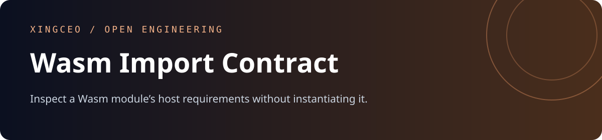
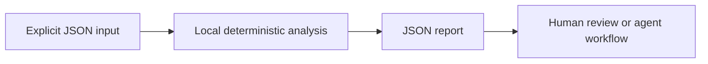

<div align="center">



[](https://github.com/XingCEO/wasm-import-contract/actions/workflows/ci.yml)

[](LICENSE)


**Inspect a Wasm module’s host requirements without instantiating it.**

[Try it](#quickstart) · [Input contract](#input-contract) · [Example report](examples/output.json) · [Contribute](CONTRIBUTING.md)

</div>

## The problem

A WebAssembly plugin can be valid yet fail in another host because an import namespace, memory limit or shared-memory requirement differs. Instantiating untrusted plugins is unnecessary for the first compatibility check.

## How it works

Decode the core Wasm binary import section from hex, including function, table, memory and global imports. Compare required names and kinds against an explicit host capability inventory. Report limits and value types for review and reject truncated encodings.



## Quickstart

Requires Python 3.11 or later. The analyzer has **no runtime dependencies**, makes no network requests and runs no shell commands. Domain-specific interpretation (such as SQL rehearsal) is described below.

```bash
git clone https://github.com/XingCEO/wasm-import-contract.git
cd wasm-import-contract
python3 -m wasm_import_contract examples/input.json
```

Optional installation into an isolated environment:

```bash
python3 -m venv .venv
. .venv/bin/activate
python -m pip install .
wasm-import-contract examples/input.json
```

The package is installed from this checkout; no PyPI publication is claimed.

## Work with native files

Use existing files directly instead of wrapping them in a JSON string:

```bash
python3 -m wasm_import_contract --wasm examples/plugin.wasm --host examples/host.json
```

The analyzer reads only the paths explicitly supplied. It does not crawl a repository or execute a Wasm module. Native file flags and the positional JSON envelope are mutually exclusive.

## Input contract

Use [the complete example](examples/input.json) as a starting point. Paths and strings in JSON are data unless the contract explicitly says they refer to local files.

| Field | Meaning |
| --- | --- |
| `wasm_hex` | Hexadecimal bytes of a core Wasm module; obtain with `Path("plugin.wasm").read_bytes().hex()`. |
| `host` | Available module/name/kind bindings. Kinds: function, table, memory, global. |

## Example result

Generated by running the committed example:

```json
{
  "findings": [
    {
      "kind": "missing_import",
      "module": "env",
      "name": "log"
    }
  ],
  "imports": [
    {
      "kind": "function",
      "module": "env",
      "name": "log",
      "type_index": 0
    }
  ],
  "name_and_kind_match": false,
  "requires_type_validation": true
}
```

## Use from another tool

```python
import json
from wasm_import_contract import analyze

with open("examples/input.json", encoding="utf-8") as stream:
    report = analyze(json.load(stream))
```

`analyze(data)` returns a JSON-serializable dictionary. The CLI accepts `-` for stdin, writes reports to stdout and input errors to stderr. Exit `0` means analysis completed, including reports containing findings; exit `2` means invalid input or an unreadable file. Gate CI on the report's documented fields, rather than assuming exit `0` means no findings. The JSON report is a v0.1 interface and may evolve before 1.0.

## Validation

```bash
python3 -m unittest discover -v
```

Tests cover the example, malformed CLI input, and the domain-specific boundary cases in [tests/test_core.py](tests/test_core.py). CI also installs the package and runs its console entry point on Python 3.11 and 3.13. Test success demonstrates these cases; it is not evidence of production deployment.

## Scope and limits

Core Wasm version 1 import inventory, not a validator or runtime. Function type signatures are exposed as type indices and are not resolved. Name/kind compatibility does not guarantee instantiation. Memory64, exception tags, typed references and component-model binaries are intentionally unsupported.

This is a focused experimental first release. Review findings before changing production systems. Inputs and reports may contain your own source or metadata; keep them in an appropriate local workspace.

## Related work and references

- [Wasm binary imports](https://webassembly.github.io/spec/core/binary/modules.html#import-section)
- [wasm-tools](https://github.com/bytecodealliance/wasm-tools)

These projects and specifications inform the problem space. This repository is an independent implementation; it does not claim to replace the referenced systems or to have invented the underlying techniques.

## Contributing

A small real-world fixture with expected behavior is the most useful contribution. See [CONTRIBUTING.md](CONTRIBUTING.md). Please remove private data before filing an issue.

## License

[MIT](LICENSE) © 2026 XingCEO.
